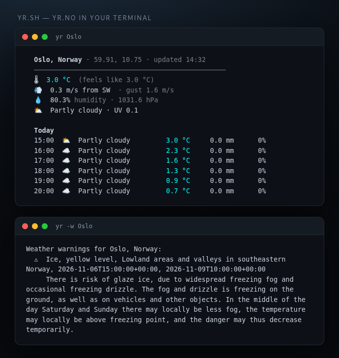

<div align="center">

# yr.sh

**Yr.no weather in your terminal — a clean forecast dashboard and desktop warnings for Norway.**

[](LICENSE)
[](#requirements)
[](#requirements)
[](https://api.met.no/)



</div>

## Why yr.sh?

`yr.sh` puts the forecast from yr.no (MET Norway) in your terminal: current conditions, an hourly table with weather icons, and active weather warnings with desktop notifications — all in one Bash script. No Python, no browser, no background daemon needed for the forecast.

## Features

- **Now panel** — temperature with feels-like, wind and gusts, humidity, pressure, UV
- **Hourly forecast** — weather icons, temperature, precipitation and rain probability
- **Day separators** — Today / Tomorrow / weekday, in your local time
- **Warnings** — MET MetAlerts for Norway, with the matching Yr warning icon
- **Desktop notifications** — `notify-send`, one-shot or as a systemd user service
- **Config-driven** — location and poll interval in `~/.config/yr.sh/config`
- **Terminal-friendly** — color on a TTY, respects `NO_COLOR`, `--plain` for scripts
- **Well-behaved** — gzip, caching per `Expires`, 4-decimal coordinates, clear HTTP errors

## Install

```bash
git clone https://github.com/tmiland/yr.sh.git
cd yr.sh
./yr.sh --install Oslo     # command + systemd user service
```

`--install` does three things:

1. symlinks `yr` into `~/.local/bin`
2. saves `location=Oslo` and `interval=600` to `~/.config/yr.sh/config`
3. installs and starts `yr.service` (systemd user) for warning notifications

Then:

```bash
yr Oslo
yr -w
```

Uninstall everything:

```bash
./yr.sh --uninstall
```

### Requirements

- Bash 4+
- `curl`, `jq`, `awk`, GNU `date`
- `libnotify` (`notify-send`) for notifications
- `zenity` for the config dialog, `rsvg-convert` for PNG icons (both optional)

## Usage

| Command | What it does |
| --- | --- |
| `yr Oslo` | forecast for a place |
| `yr 59.9139 10.7522` | forecast for coordinates |
| `yr --hours 12 Bergen` | next 12 hours |
| `yr -w` | active warnings for the configured location |
| `yr --notify Oslo` | print and desktop-notify warnings |
| `yr -ar --interval 600 Oslo` | manual warning monitor |
| `yr -c` | configure location and interval |
| `yr -i Oslo` / `yr -u` | install / uninstall |
| `yr --plain Oslo` | no icons or color (scripts) |
| `yr --help` | all options |

With no place argument, the configured location is used.

## Configuration

```bash
yr -c
```

Opens a zenity form (terminal prompts without a display) for:

```ini
# ~/.config/yr.sh/config
location=Oslo
interval=600
```

`location` can be a place name or `lat,lon`. Restart the service after editing:

```bash
systemctl --user restart yr.service
```

## Warnings service

`--install` runs this as a systemd user service:

```bash
yr --auto-run
```

Useful commands:

```bash
systemctl --user status yr.service
journalctl --user -u yr.service -f
systemctl --user restart yr.service
```

New warnings trigger a desktop notification with the matching Yr warning icon (type + yellow/orange/red level). Seen alert IDs are tracked in `~/.local/state/yr.sh/`, so each alert notifies once.

Warnings come from MET Norway's MetAlerts and cover Norway only.

## How it works

- **Forecast:** [MET Norway Locationforecast 2.0](https://api.met.no/weatherapi/locationforecast/2.0/documentation) (`complete`)
- **Warnings:** [MET Norway MetAlerts 2.0](https://api.met.no/weatherapi/metalerts/2.0/documentation)
- **Geocoding:** [Open-Meteo](https://open-meteo.com/en/docs/geocoding-api)
- **JSON:** parsed with `jq` — no Python in the script
- **Caching:** responses are reused until the server's `Expires` header; `--no-cache` bypasses

## API compliance

- User-Agent identifies the app with the project URL
- Coordinates are truncated to 4 decimals (MET requirement)
- gzip compression and local caching; no HEAD + GET
- HTTP 203 prints a deprecation warning; 403/429 fail with clear messages

Some fields (rain probability, wind gusts) are only published for parts of the world, mainly the Nordic area; elsewhere they show as `–`.

## Data and license

- Forecast and warnings: [MET Norway](https://www.met.no/) — [CC BY 4.0](https://creativecommons.org/licenses/by/4.0/) / [NLOD](https://data.norge.no/nlod/en/2.0)
- Warning icons: [Yr/NRK warning icons](https://github.com/nrkno/yr-warning-icons) — CC BY 4.0, vendored in `assets/warning-icons/`
- Geocoding: Open-Meteo
- Code: MIT — see [LICENSE](LICENSE)

Not affiliated with Yr, NRK or MET Norway.
